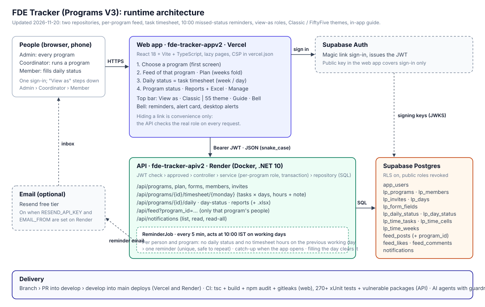

# Architecture

The current diagram is [architecture.svg](architecture.svg) (updated 2026-11-20). The older hackathon diagram is kept as [architecture.png](architecture.png) / [architecture.excalidraw](architecture.excalidraw) (open https://excalidraw.com, then Menu > Open) for history.

## Repositories

The product lives in two GitHub repositories. Each has its own build, CI and deploy.

| Repository | Holds | Deploys to |
|---|---|---|
| [`fde-tracker-appv2`](https://github.com/shr1-live/fde-tracker-appv2) (frontend) | React app in `src/`, `DESIGN.md`, `vercel.json` | Vercel project `fde-tracker-green` |
| [`fde-tracker-apiv2`](https://github.com/shr1-live/fde-tracker-apiv2) (backend) | ASP.NET Core API, `migrations/`, xUnit tests, `render.yaml`, the API contract `docs/PROGRAMS-V3.md` | Render service `fde-tracker-v3-api` |

The two talk only through the API contract. Change the contract in the backend repository first, then the frontend follows. The product-level docs (product, architecture, AI development, decisions, disclosure) are the same in both repositories; the backend copy is the source. Standards, QA, security and delivery are written per repository.

## Components

| Part | Technology | Where it runs |
|---|---|---|
| Web app (repository `fde-tracker-appv2`) | React 18, Vite, TypeScript | Vercel (free), built with Vite defaults and the root `vercel.json` of that repository |
| API (repository `fde-tracker-apiv2`) | ASP.NET Core on .NET 10, MVC style, Dapper | Render free web service, Docker, from the root `render.yaml` of that repository (`fde-tracker-v3-api`) |
| Database | Postgres | Supabase (free) |
| Sign-in | Supabase Auth (magic link, JWT) | Supabase |
| Excel | ClosedXML | Inside the API |
| Reminders | A background job in the API (every 5 minutes, acts at 10:00 IST) | Inside the API |
| Email (optional) | Resend HTTP API, free tier | Only when `RESEND_API_KEY` and `EMAIL_FROM` are set |

## Request flow

1. The browser signs in with Supabase Auth and gets a JWT.
2. The web app calls the API with `Authorization: Bearer <token>`.
3. The API checks the token (issuer and signing keys from `SUPABASE_URL`), loads the user from `app_users`, and checks the account is approved.
4. Route -> filters (approved, role) -> controller (HTTP only) -> service (rules, per-program role check, transaction) -> repository (parameterised SQL) -> view model -> JSON in snake_case.
5. Errors come back as `{ "error": "..." }` with no internal detail.

The web app never talks to the database directly. The Supabase key in the web app is the public one and only covers sign-in.

## Data model (V3 tables)

Created by migrations `010_programs_v3.sql`, `011_feed_scale.sql`, `012_notifications.sql`, `013_feed_per_program.sql` and `014_timesheets.sql`. `app_users` comes from `001_init.sql`. Migrations 002-009 belong to the older tracker features and are kept.

| Table | Holds |
|---|---|
| `app_users` | Every signed-in person: email, name, global role (`admin`, ...), access (`pending`, `approved`, `rejected`) |
| `lp_programs` | A program: name, description, start date |
| `lp_members` | Who is in a program and as what (`coordinator` or `member`) |
| `lp_invites` | Open invites by email; turned into memberships at sign-in |
| `lp_days` | The plan: week, day, topic, topics to cover, practical task |
| `lp_form_fields` | The two forms per program (`daily`, `day`): key, label, description, type, required, order |
| `lp_daily_status` | One row per person per program per date; values as JSON |
| `lp_day_status` | One row per person per plan day; values as JSON, completed flag |
| `feed_posts` | Posts: text and/or https link, stored `kind` (video, link, text), like and comment counters, `edited_at` |
| `feed_likes` | One row per like |
| `feed_comments` | Comments |
| `lp_time_tasks` | Timesheet rows: a person's own tasks for one week of one program |
| `lp_time_cells` | Hours (minutes) and a short note per task per day |
| `lp_time_weeks` | Per person, program and week: submitted or draft |
| `notifications` | In-app notifications; the first kind is `daily_missed`, unique per person, program and day |

`feed_posts.program_id` ties every post to one program: only that program's people (and the admin) can see, like or comment on it.

## Daily status reminders

1. A job in the API wakes every 5 minutes. On working days from 10:00 IST it looks at the previous working day (Monday looks at Friday).
2. For every member or coordinator of a program that had started, who was already in it that day: no daily status **and** no timesheet hours that day means one `daily_missed` reminder for that program. Example: on Thu 19 Nov someone logged DevOps but not FDE, so on Fri 20 Nov at 10:00 they get a reminder for FDE only.
3. The reminder shows in the bell, as an alert card when the app opens, as a desktop alert if allowed, and by email if email is set up. Its link opens the missed day.
4. Logging the day (timesheet hours or the old form) clears the reminder. Reminders are unique, so a restart, a second instance or the catch-up when someone opens the app never sends twice; the catch-up also covers a free server that slept through 10:00.

Form values are JSON, but the server checks every key and type against `lp_form_fields` before saving (see the contract in [PROGRAMS-V3.md in the backend repository](https://github.com/shr1-live/fde-tracker-apiv2/blob/main/docs/PROGRAMS-V3.md)).

## Authorization model

- **Invite-only.** The admin email is always admin. Anyone else is approved only when an invite exists for their email, or they were approved before V3. Unknown emails stay `pending`.
- **An invite never lifts a rejection.** If the admin rejected someone, a coordinator's invite adds them to the program but they stay locked out.
- **View as** (top bar) lets the admin see the app as a coordinator or member, and a coordinator as a member. It only changes the screens; the API still uses the real role.
- **Per-program roles are checked in services**, not only in the web app. A member asking for another person's status gets 403. A program they are not in gives 404 or 403.
- The admin can delete any post but can only edit their own.

## Key trade-offs

| Choice | Why | Cost |
|---|---|---|
| Two repositories, one for the web app and one for the API (see Repositories) | Separate deploys, separate CI, smaller blast radius, clear ownership | The contract is kept in sync by hand; shared docs are copied; a cross-cutting change needs two pull requests |
| Keyset (cursor) paging on the feed | Stable pages while new posts arrive; fast at any depth | Cursors are tied to one sort; changed cursors give 400 |
| Like and comment counters kept by triggers | Sorting by "most liked" uses an index, not a count per request; counts stay right inside the same transaction | Logic lives in SQL as well as C# |
| Excel built on the server with ClosedXML | Same file for everyone; matches the training sheet layout exactly; no big library in the browser | Larger API image; export is limited to 120 days |
| RLS on for every table, public roles revoked | The public Supabase key cannot read or write any table, even by mistake | All data goes through the API |
| Form values as JSON with server checks | Coordinators can change forms without migrations | Reporting on a single field needs JSON queries |
| Render free tier | No cost | Cold starts (first request after idle can take about a minute) |

## Limitations

- Render free tier sleeps when idle; the first call is slow.
- Email reminders need a Resend key and a verified sending domain; without them reminders are in-app only.
- No automatic sync to the SharePoint training sheets yet (needs a Microsoft 365 app registration); Reports > Download Excel gives the same layout.
- Feed posts take links only, no uploads.
- Daily reports cover at most 120 days per request.
- The main web bundle is about 133 kB gzipped; pages are lazy-loaded but the Supabase client is in the main bundle.
- One admin account; there is no admin hand-over screen.
